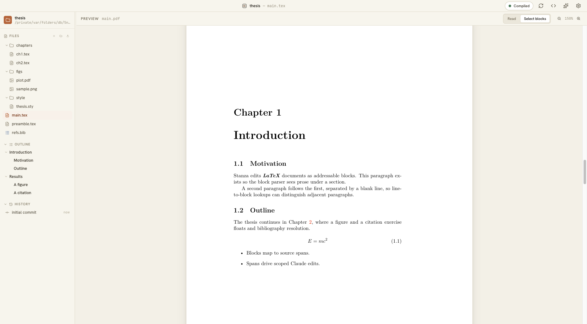
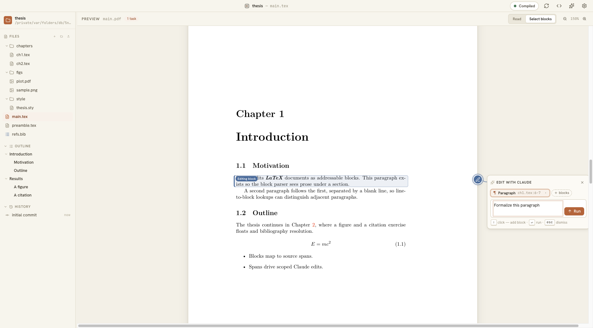
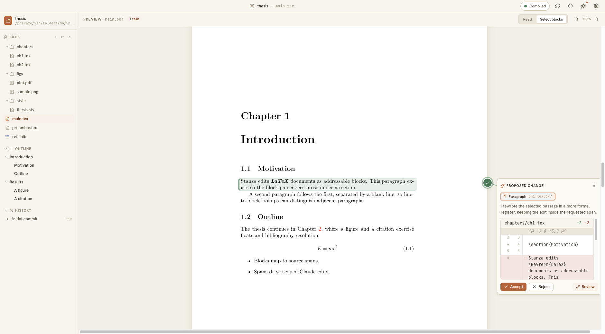
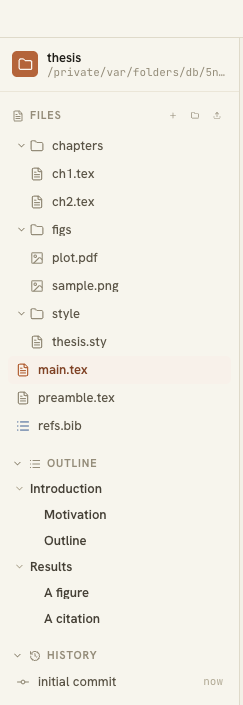
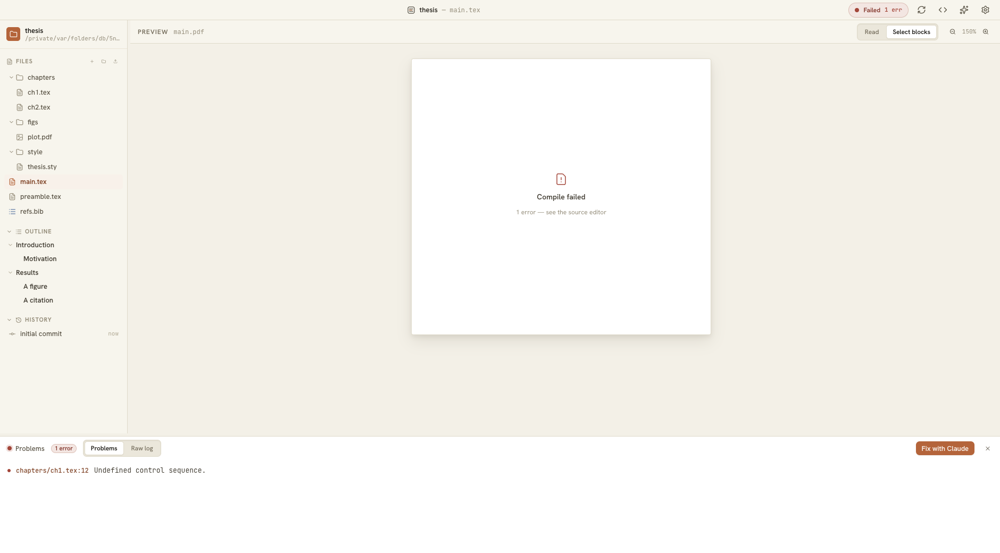

<p align="center">
  
</p>
<h1 align="center">Stanza</h1>
<p align="center"><a href="https://github.com/MiguelFernandes9/stanza/actions/workflows/ci.yml"></a></p>
<p align="center"><strong>Overleaf, with Claude.</strong> A macOS desktop app for writing LaTeX the way you read it — edit in the rendered PDF, with Claude as a block-level editing partner.</p>

A LaTeX project is parsed into addressable blocks. You select a block — a
paragraph, a section, an equation — directly in the compiled PDF, type an
instruction, and Claude Code edits the `.tex` source. Every change comes back
as a diff you accept or reject. Nothing lands in your files without your
sign-off.



> Status: pre-release (`0.1.0-alpha`), under active development. Built for a
> single local user (the author's PhD thesis is the dogfood). Expect rough
> edges; issues and feedback welcome.

## The loop

```
select blocks in the PDF  →  type an instruction
        →  Claude edits the .tex source
        →  diff proposal (margin card)
        →  accept = merge into your repo · reject = discard
        →  recompile → updated PDF
```

## Using Stanza

### 1. Open a project

Open a folder of `.tex` files (**File ▸ Open**). The left rail is your
project: a file tree, a live **outline** of titled sections, and the
document's git **history**. The center pane is the compiled PDF — press
**⌘R** to build it (tectonic runs locally). The hero shot above is a project
open and compiled.

### 2. The edit loop

Switch to **Select blocks** mode (top-right, or **⌘B** to toggle from Read).
Click any block in the PDF — a paragraph, heading, equation, figure — and a
card opens on the margin rail showing that block's source span
(`ch1.tex:6–7`). Type what should change and hit **Run**; Claude Code edits
the `.tex` source for exactly that span. You can stack several blocks into one
instruction.



### 3. Review every change

A finished edit comes back as a **proposed change**: Claude's note, a real
`git` diff, and the block marked *Awaiting review* in the PDF. **Accept**
commits it; **Reject** restores the file. Edits run as **tasks** — several can
be pending at once, each locking its own blocks while it runs, each on its own
branch in *your document's* repo. Every AI edit is attributable, revertable
history.



### 4. Find your way around

The sidebar **outline** lists your titled sections; clicking one jumps the PDF
and the source editor to it (jump-only — it never selects or edits). The file
tree hides build noise, and images or PDFs open in an in-app viewer. **⌘B**
toggles Read ↔ Select-blocks at any time.



### 5. When a compile fails

A failed build opens the **Problems** panel along the bottom: every tectonic
error, with click-to-jump to the offending source line and a raw-log tab. Hit
**Fix with Claude** to hand the whole error log over as a single edit.



## How it's built

| concern | choice |
|---|---|
| Shell | Electron + React + TypeScript + Vite |
| Source format | real LaTeX, compiled locally with [tectonic](https://tectonic-typesetting.github.io) (`--synctex`) |
| PDF ↔ source mapping | SyncTeX + the pdf.js text layer, both directions |
| Claude bridge | Claude Code CLI, headless (`claude -p`) — one session per document; no API keys in the app |
| Review | git, in the document's own repo — accept = commit, reject = restore |
| Editor | CodeMirror 6 (source pane), pdf.js (preview) |

The app never calls the Anthropic API directly: it drives your existing
`claude` login, and Claude edits files with its own tools.

## Repository layout

```
src/shared/    pure logic + types: IPC contract, block model, LaTeX utils
src/main/      Electron main: services (document, compile, claude, review)
               over an infra layer (process, git, watcher, store)
src/renderer/  React UI: feature folders + design-system components
design/        design system v0.1 — tokens, component kit, interaction contract
docs/          project context + feature specs
fixtures/      sample LaTeX projects used by the test suites
tests/         unit + Playwright-electron e2e (Claude played by a mock)
```

Start with [docs/PROJECT.md](docs/PROJECT.md) for what the app does and its
current state. The visual source of truth is [design/](design/), versioned by
its [changelog](design/DESIGN_CHANGELOG.md).

## Install

Stanza is distributed as source for now. There is no signed release yet.

**Prerequisites**

- macOS, [Node.js](https://nodejs.org) 20 or newer, and `git`
- [tectonic](https://tectonic-typesetting.github.io) for LaTeX builds: `brew install tectonic`
- [Claude Code](https://claude.com/claude-code) CLI, installed and logged in
  (run `claude` once in a terminal). Stanza uses your existing login and never
  asks for an API key.

**Run from source**

```bash
git clone https://github.com/MiguelFernandes9/stanza.git
cd stanza
npm install
npm run dev
```

**Build a local app** (optional)

```bash
npm run dist        # packages Stanza with electron-builder into dist/
```

The build is unsigned, so macOS Gatekeeper will warn on first launch.
Right-click the app and choose **Open** to run it anyway.

**Your first project:** open any folder of `.tex` files with **File ▸ Open**.
If the folder isn't a git repository yet, Stanza initialises one, because
review history lives in your document's own repo.

## Security and privacy

> **Only open projects from people you trust.** Stanza is pre-release. A
> project folder crafted by someone else (a downloaded template, a cloned
> repository, a zip with its `.git` folder) may be able to overwrite files
> elsewhere on your computer or steer the AI agent. Details in
> [SECURITY.md](SECURITY.md#known-limitations).

- **Local-first.** Your files stay on your machine. The only network traffic
  comes from the Claude Code CLI (to Anthropic, under your account) and, if
  you use spell-check, dictionary downloads.
- **Nothing lands without review.** Every AI edit runs in an isolated git
  worktree and reaches your files only when you accept its diff.
- **Some protections against hostile projects.** A project's own Claude Code
  settings, `CLAUDE.md` and MCP servers are ignored, the agent can't run shell
  commands, the project's git hooks don't run, Stanza warns before opening a
  repository with unusual git config, and LaTeX shell-escape is off unless you
  enable it. These protections are not complete yet (see the warning above).
- **Prompt injection is a real risk.** Text in a file the agent reads can try
  to steer it. **Web access is on by default** so the agent can look up
  references, which means an injected instruction could send project content
  to a website. Turn web access off in Settings for confidential or
  unpublished work.

The full trust model and how to report a vulnerability are in
[SECURITY.md](SECURITY.md).

## Development

```bash
npm test             # unit suites (no LaTeX needed)
npm run typecheck
npm run test:e2e     # Playwright-electron, mocked Claude, real builds
npm run test:integration   # real tectonic compiles of fixtures/
```

To regenerate the screenshots in this README from the current UI:

```bash
npm run build && node tests/e2e/capture-readme-shots.mjs
```

## Design

Stanza's interface is an editorial workstation: parchment surfaces, ink
typography, one clay accent, printer's-ink diff colors. The full design
system — tokens, components, app mocks, and the interaction contract the
implementation follows — lives in [design/](design/).

## License

[MIT](LICENSE) © 2026 Miguel Fernandes. Bundled fonts are under the SIL Open
Font License; see [THIRD_PARTY_NOTICES.md](THIRD_PARTY_NOTICES.md).
